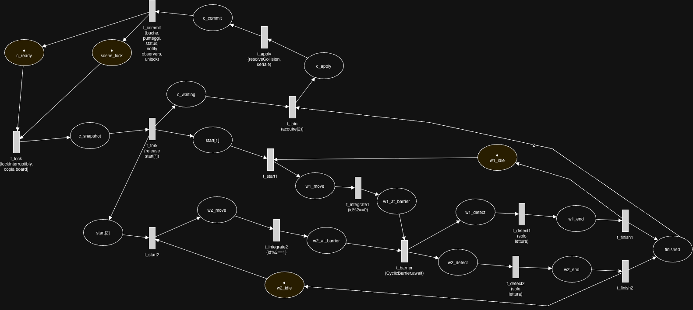
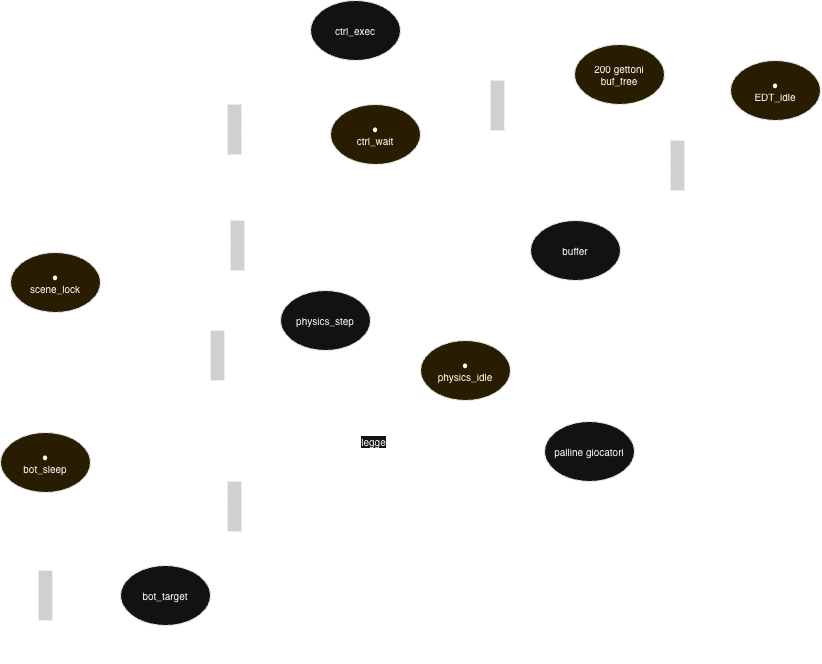
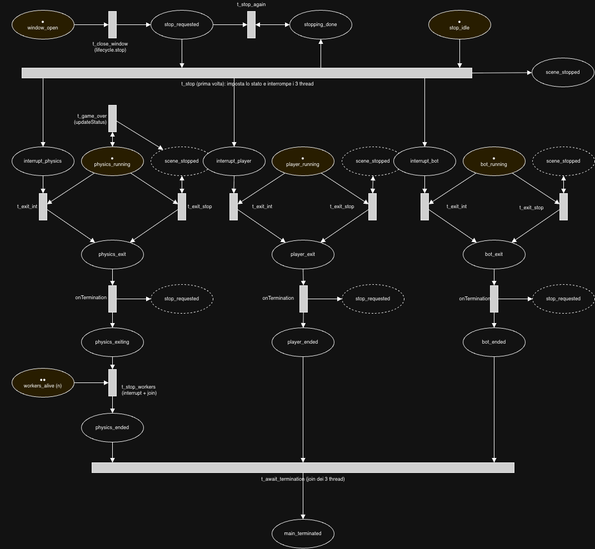

# Documentazione

## Autori
- Mattia Senni (mattia.senni@studio.unibo.it)
- Fabio Fattori (fabio.fattori3@studio.unibo.it)
- Francesco Tonelli (francesco.tonelli9@studio.unibo.it)

## Analisi

Le principali attività concorrenti da valutare sono state:
- l'aggiornamento di posizione e velocità di un numero elevato di palline a ogni passo. Il rilevamento delle collisioni (O ($N^2$) in versione naive) è il principale collo di bottiglia;
- l'input asincrono del giocatore umano da tastiera che modifica la velocità della sua pallina;
- il processo processo autonomo che applica impulsi alla pallina del bot a intervalli selezionati;
- il rendering della grafica, separato dal calcolo per permette all'applicazione di rimanere reattiva.

Di conseguenza, i principali aspetti critici riscontrati sono stati:
- la gestione dello stato condiviso, ovvero di molte variabili che sono lette e scritte da più thread, quindi sono necessari accessi protetti;
- gli urti, i quali coinvolgono due palline, quindi worker diversi potrebbero scrivere sulla stessa pallina (con rischio di update persi);
- la sincronia: le fasi di ogni passo hanno un ordine preciso e i worker devono attendersi a fine fase;
- la GUI, la quale deve ricevere uno snapshot coerente dello stato, senza leggere dati a metà aggiornamento;
- la gestione del game over, la quale richiede uno stop coordinato di più thread, senza deadlock né thread orfani.

## Architettura

Il progetto è organizzato secondo il pattern Model-View-Controller (MVC), mantenendo separati la logica di gioco, la gestione degli input e la rappresentazione grafica. Questa struttura viene mantenuta in tutte e tre le versioni.

### Versione sincrona

Nella versione sincrona ([vsynchronized](https://github.com/Caffeine-And-Code/PCD-assignment-1/tree/d7be7ddd448c2c60d066f1e16673c332c3f10349/src/pcd/poool/vsynchronized)), non richiesta ma sviluppata allo scopo di avere un riferimento per i test di performance, l'architettura è suddivisa nei seguenti componenti:

- Model: contiene le entità del gioco e la logica fisica. La classe `Board` rappresenta lo stato condiviso
  e agisce da monitor tramite un `ReentrantLock`, garantendo l'accesso mutuamente esclusivo durante gli aggiornamenti
  della simulazione;
- View: gestisce la rappresentazione grafica tramite Swing. La classe `View` implementa `BoardObserver` e
  riceve le notifiche di aggiornamento dal Model. Il `ViewModel` mantiene una copia dei dati necessari al rendering,
  ottenuta attraverso gli snapshot del `Board`;
- Controller: gestisce gli input e l'esecuzione della simulazione. `PooolController` riceve i comandi
  della tastiera attraverso un buffer thread-safe (`BoundedBufferImpl`, monitor con `synchronized`/`wait`/
  `notifyAll`), mentre `PhysicsLoop` esegue gli aggiornamenti fisici su un thread dedicato.

In questa versione, il calcolo fisico viene eseguito sequenzialmente da un unico thread, mentre la gestione dei comandi e la GUI operano su thread separati.

Le altre due versioni mantengono la stessa organizzazione MVC, introducendo differenti strategie per parallelizzare il calcolo: la versione con thread nativi ([vnativethreads](https://github.com/Caffeine-And-Code/PCD-assignment-1/tree/d7be7ddd448c2c60d066f1e16673c332c3f10349/src/pcd/poool/vnativethreads)) utilizza un numero fisso di thread per distribuire il lavoro, mentre la versione con Executor framework ([vjavaexecutorframework](https://github.com/Caffeine-And-Code/PCD-assignment-1/tree/d7be7ddd448c2c60d066f1e16673c332c3f10349/src/pcd/poool/vjavaexecutorframework)) utilizza quest'ultimo per eseguire le fasi di calcolo come task su un pool di thread.

### Versione con thread nativi

I principali componenti della versione con thread nativi sono:
- `PhysicsLoop`, che coordina un numero configurabile di worker, di base `availableProcessors() - 1` con un minimo di 1; 
- EDT di Swing, `PlayerController` e `BotController`, i quali gestiscono rispettivamente tastiera, comandi e bot;
- `GameLifecycle` centralizza avvio, interruzione e attesa dei thread. I comandi passano attraverso un `BoundedBufferImpl` da 200 elementi senza bloccare la GUI.
- `Scene` protegge board, punteggi e stato con un `ReentrantLock`: fisica e impulsi sono quindi serializzati e la View osserva solo stati completi. 

Durante un passo il coordinatore lavora su una copia del board e assegna le palline ai worker in round-robin. Il passo segue queste fasi:
1. il coordinatore rilascia i semafori;
2. i worker aggiornano in parallelo le proprie palline e si sincronizzano;
3. i worker rilevano in parallelo le collisioni, scrivendo ciascuno nelle proprie liste;
4. il coordinatore attende i permessi, controlla gli errori e applica le collisioni;
5. `Scene` esegue il commit, aggiorna punteggi e stato e notifica la View.

Gli impulsi possono essere applicati solo tra due passi. Un errore in un worker porta la partita in `IN_EXCEPTION` e la terminazione interrompe e attende tutti i thread.

### Versione con Executor Framework

Questa versione mantiene molti degli aspetti precedenti, ma usa un `ExecutorService` condiviso. 
- `GameLifecycle` invia al pool `PlayerController`, `BotController` e `PhysicsLoop`; 
- a ogni passo la fisica crea un gruppo di task per il movimento e uno per il rilevamento delle collisioni;
- `invokeAll` attende ciascuna fase e `Future.get` propaga gli errori;
- `PhysicsLoop` applica serialmente le collisioni ed esegue il commit.

## Comportamento

### Rete 1: passo di simulazione

Questa rete descrive un passo di simulazione della versione con thread nativi.

Per leggibilità, questa rete considera un caso in cui vengono impegnati due worker.



- `scene_lock` garantisce la mutua esclusione per l'intero passo; 
- dopo il fork, la barriera impedisce di cercare collisioni prima che tutti abbiano concluso il movimento; 
- il join richiede un segnale `finished` per worker;
- I rilasci eseguiti nei `finally` evitano blocchi anche in caso di errore. 
- I posti di controllo sono 1-limitati, quindi due passi non possono sovrapporsi.

### Rete 2: giocatori e stato condiviso

Questa rete comportamentale è comune a entrambe le versioni concorrenti.



Il buffer limitato disaccoppia EDT e `PlayerController`: a buffer vuoto il controller attende, mentre a buffer pieno l'EDT scarta il comando senza bloccarsi. Fisica, giocatore e bot condividono `scene_lock`, quindi la GUI resta reattiva.

### Rete 3: terminazione

Questa rete comportamentale descrive un principio comune a entrambe le versioni concorrenti.



A fine partita, la chiusura della finestra o uscita di un thread producono la stessa richiesta di stop idempotente.
- `GameLifecycle` interrompe fisica, giocatore e bot; 
- il coordinatore interrompe e attende i worker;
- l'interruzione sblocca anche chi attende nel buffer o sui sincronizzatori, e `main` termina solo dopo tutti i `join`. 

Nella versione con Executor lo stesso comportamento è ottenuto con `shutdownNow` e `awaitTermination` sul pool.

## Argomentazioni

- il round-robin è stato considerato per bilanciare i controlli;
- i worker rilevano le collisioni senza modificare le palline, mentre il controller applica questi update. Si evitano così race conditions e lock, al costo di una fase seriale.
- il lavoro su una copia e il commit atomico impediscono agli osservatori di vedere stati parziali.
- il rilevamento di collisioni, i commit, la gestione degli errori e il lock della scena costituiscono il principale limite di scalabilità.

## Performance Test

Il benchmark sviluppato misura la sola fisica delle palline, confrontando le versioni concorrenti con quella sincrona. I tre programmi eseguono lo stesso algoritmo su 4500 palline. Ogni risultato è la media di 3 prove, dopo 20 passi di warm-up (necessari in quando si sono notate delle discrepanze in loro assenza, specialmente su dispositivi datati) e su 30 passi misurati con `System.nanoTime()`. Questi test vengono calcolati su un numero di worker che va da 1 al numero dei processori disponibili, raddoppiando a ogni iterazione. 

Si riportano in seguito le misurazioni restituite dall'esecuzione dei test, la cui bontà è stata calcolata in base ai seguenti parametri:
- tempo per passo `T(n)`;
- throughput `1/T(n)`; 
- speedup `S(n) = T_seq/T(n)`;
- efficienza `E(n) = S(n)/n`.

| Implementazione    | Worker | Throughput (upd/s) | Responsiveness (ms) | Speedup | Amdahl `S_inf` | Efficienza |
|--------------------|-------:|-------------------:|--------------------:|--------:|---------------:|-----------:|
| Sequenziale        |      1 |               5,66 |               91,64 |    1,00 |           1,00 |     100,0% |
| Thread nativi      |      1 |              21,55 |               72,75 |    3,81 |           2,87 |     100,0% |
| Thread nativi      |      2 |              29,77 |               48,85 |    5,26 |           2,87 |      69,1% |
| Thread nativi      |      4 |              39,32 |               36,05 |    6,95 |           2,87 |      45,6% |
| Thread nativi      |      8 |              50,18 |               26,19 |    8,87 |           2,87 |      29,1% |
| Executor Framework |      1 |              30,83 |               47,70 |    5,45 |           2,44 |     100,0% |
| Executor Framework |      2 |              41,89 |               56,41 |    7,40 |           2,44 |      67,9% |
| Executor Framework |      4 |              48,81 |               33,95 |    8,62 |           2,44 |      39,6% |
| Executor Framework |      8 |              63,80 |               22,30 |   11,27 |           2,44 |      25,9% |

Entrambe le versioni concorrenti migliorano nettamente il riferimento sequenziale. All'aumentare dei worker cresce il throughput e, salvo normali oscillazioni dovute allo scheduling, diminuisce il tempo di risposta.

Si nota che la crescita non è però lineare: l'efficienza diminuisce all'aumentare dei worker, fino al 29,1% per i thread nativi e al 25,9% per l'Executor con 8 worker. Il risultato può essere considerato coerente con l'overhead di coordinamento e con le fasi seriali di applicazione delle collisioni e commit, come sopracitato.

## Model-Checking

JPF esplora due modelli finiti:
- `BoundedBufferJpfTest` verifica FIFO, svuotamento e terminazione sul buffer reale;
- `PhysicsStepJpfTest` verifica con 2 worker che movimento, barriera e collisioni rispettino l'ordine previsto e terminino.

Le asserzioni e `PreciseRaceDetector` controllano anche eccezioni, deadlock e data race.

Vengono di seguito riportati i risultati emessi dall'esecuzione di JPF sul progetto:
- `pcd.test.jpf.BoundedBufferJpfTest.main()`: no errors detected;
- `pcd.test.jpf.PhysicsStepJpfTest.main()`: no errors detected.

## Avvio dell'applicazione e dei test

Selezionare in `src/pcd/poool/Main.java` uno tra `SYNCHRONIZED`, `NATIVE_THREADS`, `EXECUTOR_FRAMEWORK` e
`PERFORMANCE_TEST`.

Compilazione e avvio della modalità selezionata:

```powershell
mvn clean package
java -jar target/pcd-ass-01-1.0-SNAPSHOT.jar
```

Avvio dei test JPF:

```powershell
./jpf/run.ps1 -JpfHome C:/path/to/jpf-core -JavaHome C:/path/to/jdk-11
```
