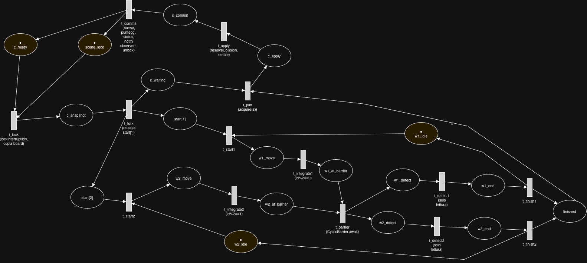
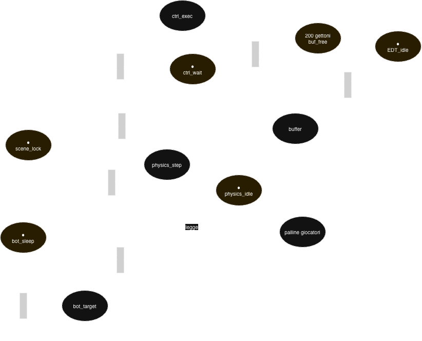
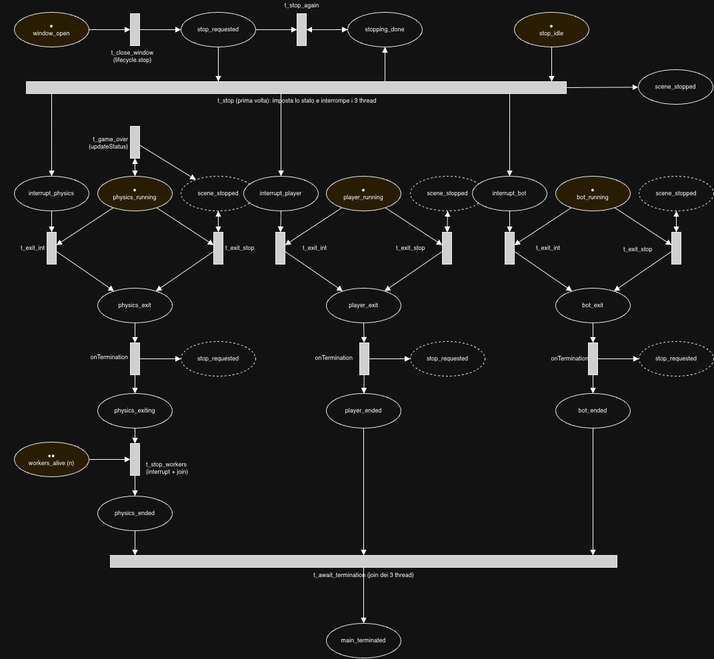

# Report

## Analisi

### Il problema

Il sistema simula un biliardo 2D con migliaia di palline piccole e due palline grandi (umano e bot), con attrito,
rimbalzi e urti elastici. Il punteggio cresce quando un giocatore manda una pallina piccola in buca; la partita termina
quando non restano palline o quando la pallina di un giocatore finisce in buca.

### Attività concorrenti

- **Fisica**: aggiornamento di posizione e velocità di migliaia di palline a ogni passo. L'integrazione del moto è
  data-parallel, mentre il rilevamento delle collisioni (O (N²) in versione naïve) è il collo di bottiglia.
- **Giocatore umano**: input asincrono da tastiera (thread della GUI) che, tramite il controller, modifica la velocità
  della sua pallina.
- **Bot**: attività autonoma che applica impulsi alla propria pallina a intervalli propri.
- **GUI**: rendering periodico, separato dal calcolo per restare reattivi.

### Aspetti critici

- **Stato condiviso**: velocità delle palline dei giocatori, punteggi, stato di gioco e lista delle palline in gioco
  sono letti e scritti da più thread, quindi servono accessi protetti.
- **Collisioni**: un urto coinvolge due palline, quindi worker diversi potrebbero scrivere sulla stessa pallina (lost
  update).
- **Sincronizzazione dei passi**: le fasi di ogni passo hanno un ordine preciso e i worker devono attendersi a fine
  fase.
- **Vista**: la GUI deve ricevere uno snapshot coerente dello stato, senza leggere dati a metà aggiornamento.
- **Terminazione**: la fine partita (o la chiusura della finestra) richiede uno stop coordinato di più thread, senza
  deadlock né thread orfani.

## Architettura

Il progetto è organizzato secondo il pattern **Model-View-Controller (MVC)**, mantenendo separati la logica di gioco, la
gestione degli input e la rappresentazione grafica. Questa struttura viene mantenuta in tutte e tre le versioni, che si
differenziano per le modalità di gestione della concorrenza.

Nella **versione
0 ([vsynchronized](https://github.com/Caffeine-And-Code/PCD-assignment-1/tree/d7be7ddd448c2c60d066f1e16673c332c3f10349/src/pcd/poool/vsynchronized))**,
l'architettura è suddivisa nei seguenti componenti:

- **Model (`model`)**: contiene le entità del gioco e la logica fisica. La classe `Scene` rappresenta lo stato condiviso
  (board, punteggi, stato della partita) e agisce da monitor tramite un `ReentrantLock`, garantendo l'accesso
  mutuamente esclusivo durante gli aggiornamenti della simulazione e l'applicazione degli impulsi. Il `Board` contiene
  le palline ed espone copie difensive dello stato.
- **View (`view`)**: gestisce la rappresentazione grafica tramite Swing. La classe `View` implementa `BoardObserver` e
  riceve le notifiche di aggiornamento dal Model. Il `ViewModel` mantiene una copia dei dati necessari al rendering,
  ottenuta leggendo lo stato della `Scene`.
- **Controller (`controller`)**: gestisce gli input e l'esecuzione della simulazione. `PooolController` riceve i comandi
  della tastiera attraverso un buffer limitato thread-safe (`BoundedBufferImpl`, monitor con `synchronized`/`wait`/
  `notifyAll`), mentre `PhysicsLoop` esegue gli aggiornamenti fisici su un thread dedicato.

La versione sincrona costituisce la base di riferimento: il calcolo fisico viene eseguito sequenzialmente da un unico
thread, mentre la gestione dei comandi e la GUI operano su thread separati.

Le altre due versioni mantengono la stessa organizzazione MVC, introducendo differenti strategie per parallelizzare il
calcolo:

- **Versione
  1 ([vnativethreads](https://github.com/Caffeine-And-Code/PCD-assignment-1/tree/d7be7ddd448c2c60d066f1e16673c332c3f10349/src/pcd/poool/vnativethreads))**:
  utilizza un numero fisso di thread di piattaforma per distribuire il lavoro, coordinati mediante una barriera tra le
  fasi della simulazione.
- **Versione
  2 ([vjavaexecutorframework](https://github.com/Caffeine-And-Code/PCD-assignment-1/tree/d7be7ddd448c2c60d066f1e16673c332c3f10349/src/pcd/poool/vjavaexecutorframework))**:
  utilizza l'Executor Framework per eseguire le fasi di calcolo come task su un pool di thread, attendendone il
  completamento tramite `Future`.

### Versione con thread nativi (`vnativethreads`)

#### Thread in gioco

| Thread           | Classe                         | Ruolo                                                                                                                                            |
|------------------|--------------------------------|--------------------------------------------------------------------------------------------------------------------------------------------------|
| EDT di Swing     | `ViewFrame`                    | cattura i tasti e li consegna al controller con `offer` (non bloccante: se il buffer è pieno il comando viene scartato, per non bloccare la GUI) |
| `poool-commands` | `PooolController`              | preleva i comandi dal buffer ed esegue l'impulso sul giocatore                                                                                   |
| `poool-bot`      | `BotPlayer`                    | ogni 700 ms sceglie una pallina a caso e applica un impulso verso di essa                                                                        |
| coordinatore     | `PhysicsLoop`                  | esegue il ciclo di simulazione e coordina i worker                                                                                               |
| worker 1..n      | thread creati da `PhysicsLoop` | eseguono in parallelo integrazione e rilevamento collisioni                                                                                      |

Il numero di worker è un parametro (argomento da riga di comando); di default vale `availableProcessors() - 1`
(minimo 1), lasciando un core al coordinatore e alla GUI.

#### Strumenti di sincronizzazione

- `Scene`: monitor realizzato con `ReentrantLock` (fair). Protegge board, punteggi, stato e fps, e serializza tra loro
  passi di fisica e impulsi dei giocatori. Gli osservatori vengono notificati mentre il lock è tenuto, quindi la View
  riceve sempre uno stato coerente.
- `Semaphore start[i]`: il coordinatore "sveglia" il worker *i* all'inizio di ogni passo.
- `CyclicBarrier movementDone`: tutti i worker devono aver finito l'integrazione prima che qualcuno inizi a cercare
  collisioni.
- `Semaphore finished`: il coordinatore attende *n* permessi, uno per worker, prima di applicare le collisioni.
- `BoundedBufferImpl`: buffer limitato (200 comandi) tra EDT e controller, scritto come monitor.

#### Partizione del lavoro

Con *n* worker, il worker *w* gestisce le palline con `id % n == w` (round-robin). Esempio: con 2 worker e 4 palline,
il worker 0 gestisce le palline 0 e 2, il worker 1 le palline 1 e 3. Le due palline dei giocatori sono accodate a quelle
piccole nella lista di lavoro, quindi sono trattate come le altre.

#### Fasi di ogni passo

Il coordinatore prende il lock della `Scene` per tutta la durata del passo e lavora su una **copia** del board.

1. **Fork**: il coordinatore prepara i dati condivisi del passo (lista palline, `dt`, liste delle collisioni, array
   degli errori) e rilascia i semafori `start[i]`.
2. **Integrazione** (parallela): ogni worker aggiorna posizione, velocità, attrito e rimbalzi sui bordi delle *sole*
   proprie palline. **Barriera.**
3. **Rilevamento collisioni** (parallelo, sola lettura): ogni worker controlla le coppie `(i, j)` con `i` propria e
   `j > i`, e registra `j` nella lista `collisions[i]`. Ogni lista ha un solo scrittore. Poi il worker rilascia
   `finished`.
4. **Join**: il coordinatore acquisisce *n* permessi da `finished`.
5. **Applicazione collisioni** (seriale, coordinatore): risolve gli urti registrati e aggiorna l'ultimo giocatore che ha
   colpito ciascuna pallina.
6. **Commit** (`Scene`): rimozione delle palline in buca, aggiornamento dei punteggi (solo se l'ultima pallina a
   colpirla era un giocatore), aggiornamento dello stato di gioco, notifica alla View e rilascio del lock.

Gli impulsi dei giocatori non si inseriscono mai a metà passo: sia il controller sia (dopo la correzione) il bot li
applicano con `Scene.updateBoard`, che richiede lo stesso lock del passo di fisica. Un impulso ha quindi effetto tra un
passo e il successivo.

## Comportamento (reti di Petri)

Le reti sono a un livello di astrazione intermedio: i posti con un solo gettone rappresentano il punto di controllo di
un thread, i posti dei semafori e dei lock rappresentano le risorse. Il numero di worker è fissato a 2 per leggibilità;
con *n* worker si replica il ramo del worker e il peso dell'arco `finished → t_join` diventa *n*. Gli archi con doppia
freccia sono archi di sola lettura.

### Rete 1: un passo di simulazione

Mostra il fork-join tra coordinatore e worker.

- Il posto `scene_lock` ha un gettone: `t_lock` lo preleva e `t_commit` lo restituisce, quindi per tutto il passo nessun
  altro thread può modificare la `Scene`.
- `t_fork` produce un gettone in ogni `start[i]` e porta il coordinatore in `c_waiting`.
- `t_barrier` è abilitata solo quando **tutti** i worker sono in `w*_at_barrier`: nessun worker può eseguire
  `t_detect` prima che tutti abbiano concluso `t_integrate`. Questo garantisce che la fase di rilevamento legga
  posizioni
  non più modificate.
- `t_join` richiede *n* gettoni in `finished` e il gettone di `c_waiting`: la fase di applicazione parte solo dopo che
  tutti i worker hanno finito. Al termine di `t_finish` ogni worker torna in `w*_idle`, pronto per il passo successivo.
- Proprietà visibili sulla rete: il ciclo è vivo (nessuna transizione resta bloccata se i worker non falliscono), i
  posti `w*_idle` e `c_ready` sono 1-limitati (nessun passo si sovrappone al successivo) e `scene_lock` è 1-limitato
  (mutua esclusione).

### Rete 2: giocatori e stato condiviso

Mostra come umano, bot e fisica competono per `scene_lock`.

- Il buffer dei comandi è modellato con la coppia di posti `buffer` / `buf_free` (200 gettoni): `t_key` consuma un posto
  libero, `t_get` lo restituisce. Il caso "buffer pieno → comando scartato" non è disegnato (richiederebbe un arco
  inibitore); il caso "buffer vuoto → il controller attende" emerge dal fatto che `t_get` non è abilitata senza
  gettoni in `buffer`.
- `t_exec`, `t_kick` e `t_phys_start` condividono `scene_lock`, quindi sono in mutua esclusione: gli impulsi non possono
  mai interferire con un passo di fisica.
- L'EDT non entra mai in competizione per il lock: lo scarico in coda è non bloccante, per questo la GUI resta
  reattiva anche con migliaia di palline.

### Rete 3: terminazione

Mostra i due percorsi di terminazione.

- **Fine partita**: `t_game_over` imposta il flag `game_over`. Il coordinatore esce dal ciclo (`t_exit_gameover`) e il
  bot, al risveglio, esce a sua volta (`t_bot_exit_gameover`).
- **Chiusura della finestra**: il controller viene interrotto; nel suo `finally` interrompe fisica e bot
  (`t_ctrl_exit`), che escono tramite `t_exit_interrupted` / `t_bot_exit_interrupted`.
- In entrambi i casi il coordinatore, prima di terminare, interrompe i worker (bloccati su `start[i]`) e li attende con
  `join` (`t_interrupt_workers`, `t_join_workers`). Si arriva così a `physics_ended` con tutti i thread conclusi, cioè
  senza thread orfani.

## Argomentazioni

- **Round-robin vs blocchi contigui.** Il vincolo `j > i` sbilancia il carico: la pallina 0 controlla N-1 coppie,
  l'ultima nessuna. Con blocchi contigui il primo worker sarebbe molto più carico. Il round-robin mescola id alti e
  bassi e bilancia il lavoro.
- **Vincolo `j > i`.** Dimezza i controlli (N (N-1)/2 coppie invece di N (N-1)) senza richiedere coordinamento tra i
  worker per decidere chi tratta una coppia.
- **Rilevamento e applicazione separati.** Il vincolo `j > i` evita i check doppi ma non il conflitto di scrittura: il
  worker che gestisce `i` dovrebbe modificare anche `j`, che appartiene a un altro worker. Registrare le collisioni in
  una fase di sola lettura e applicarle in una fase successiva elimina il problema senza lock fine-grained, evitando
  deadlock e over-synchronization. Nella versione con thread nativi l'applicazione è eseguita dal coordinatore in modo
  seriale: è la scelta più semplice e sicura, a costo di una parte non parallelizzata.
- **Lavoro su una copia del board.** Il passo di fisica opera su una copia, e solo al commit lo stato della `Scene`
  viene
  sostituito: gli osservatori vedono sempre stati completi.
- **Numero di worker legato ai core** invece di un thread per pallina, per evitare l'overhead di migliaia di thread.
- **Semafori e barriera.** Si usano `Semaphore` e `CyclicBarrier` di `java.util.concurrent` per coordinare i worker,
  mentre il buffer dei comandi è un monitor scritto a mano con `synchronized`/`wait`/`notifyAll`.
- **Limiti noti.**
  - Il rilevamento resta O (N²): una griglia spaziale ridurrebbe i controlli alle sole palline vicine.
  - La fase di applicazione delle collisioni e il commit sono seriali (legge di Amdahl).
  - Il lock della `Scene` è tenuto per tutto il passo, quindi un impulso attende al più la durata di un passo.
  - Se un worker lancia un'eccezione durante l'integrazione, non raggiunge la barriera e gli altri restano in attesa:
    l'errore è registrato ma il passo non si completa.

## Performance Tests With Results

*Da completare con i dati misurati.* Struttura suggerita:

- **Metodo**: tempo medio per passo di simulazione (escluso il rendering), su almeno 100 passi dopo un warm-up, mediato
  su
  più esecuzioni. Parametri: N ∈ {1000, 5000, 10000, 20000} palline, numero di worker ∈ {1, 2, 4, …, core disponibili}.
  Indicare CPU, numero di core e versione di Java.
- **Speedup** `S(n) = T_seq / T_par(n)` rispetto alla versione `vsynchronized`.
- **Efficienza** `E(n) = S(n) / n`, per valutare quanto bene si sfruttano i core.
- **Discussione**: confronto con il limite di Amdahl dovuto alle fasi seriali (applicazione collisioni, commit), effetto
  dello sbilanciamento e dell'overhead di sincronizzazione per N piccolo.

| N     | Sequenziale (ms/passo) | 1 worker | 2 worker | 4 worker | … | Speedup max |
|-------|------------------------|----------|----------|----------|---|-------------|
| 1000  |                        |          |          |          |   |             |
| 10000 |                        |          |          |          |   |             |

## Model-Checking

*Da completare.* Proposta di perimetro per JPF, con istanze piccole (2 worker, 3–4 palline, 1–2 passi):

- il protocollo coordinatore–worker (`start`, `CyclicBarrier`, `finished`);
- il `BoundedBufferImpl` (produttore/consumatore);
- la sequenza di terminazione (interruzione e `join` dei worker).

Proprietà da verificare: assenza di deadlock, assenza di data race sulle liste delle collisioni e sulle palline
(`PreciseRaceDetector`), terminazione di tutti i thread.